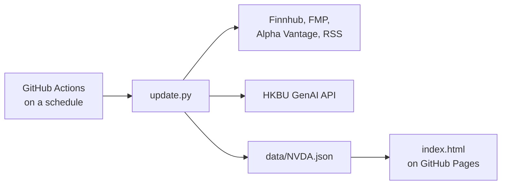

# Stock Tracker

A self-updating stock research dashboard that runs for free on GitHub. It pulls prices, fundamentals, analyst data and news for a company every 30 minutes during US trading hours, uses AI to sort the news and write a short brief, and shows everything on a phone-friendly web page.

I built it to follow NVIDIA (NVDA) while I dollar cost average into it, but any company can be added through one settings file.

**Live page:** [add your GitHub Pages link here]


## Why I built it

Free stock apps show the price but not the reasons. I wanted one place that answers three questions every time I open it: what happened to the stock, why it happened, and whether it changes the long-term story. I also wanted to practise the way an equity analyst thinks, so the tracker follows forward earnings, estimate revisions, price targets, insider trades and a set of business drivers I picked myself.

## What the page shows

| Tab | What is on it |
|---|---|
| Today | Live price, move against the Nasdaq 100 and chip sector funds, an AI brief in three sentences, what changed since my last visit, and a countdown to the next catalyst |
| News | Headlines from four sources grouped into stories, tagged good or bad news, ranked by importance, with a 7-day news mood bar and topic filters |
| Outlook | A daily AI outlook: what could happen next and over what timeframe, a scorecard for each business driver, and what would confirm the bull or bear case |
| Numbers | Price chart against benchmarks, valuation (forward P/E, PEG, EV/EBITDA, free cash flow yield), EPS forecasts and 30-day revisions, analyst ratings and price targets, earnings beats and misses, margins, insider trades and peers |
| My plan | A log of my DCA buys with average cost and gain, a bull/base/bear value calculator, and my own stop rules. This data stays on my phone only |

## How it works



There is no server and no database. A scheduled GitHub Actions job runs the Python script, saves the results to a JSON file in the repo, and commits it. The web page is a single static file that reads that JSON.

**Schedule (Hong Kong time):** every 30 minutes from 9pm to 5:30am on US trading days, every 2 hours outside trading hours, and a few extra news checks on weekends. GitHub sometimes delays or skips scheduled runs, so the page always shows when the data was last updated.

**Daily and per-run work:** prices and news are refreshed on every run. Slower data such as fundamentals, estimates, analyst grades, earnings dates and insider trades is refreshed once a day to save API calls.

## Data sources

| Source | Used for |
|---|---|
| [Finnhub](https://finnhub.io) | Quotes, market status, company news, key metrics, recommendation trends, earnings history and calendar, insider trades |
| [Financial Modeling Prep](https://financialmodelingprep.com) | Analyst estimates, price targets and grades, valuation ratios, quarterly income statements, daily price history |
| [Alpha Vantage](https://www.alphavantage.co) | Daily prices for the benchmark funds (QQQ and SOXX) |
| Yahoo Finance and Google News RSS | Extra headlines, no key needed |

All of these are used on their free plans. Free plans change often, so the script tests each endpoint and remembers the ones that need a paid plan in `data/_capabilities.json`. Those are skipped for seven days and then checked again, which keeps the daily call budget for the endpoints that work.

## The AI layer

The AI does three jobs through the HKBU GenAI API:

1. **Sort the news.** Each new headline gets a short summary, a good, bad or neutral tag, an importance level and a topic. Headlines about the same event are grouped into one story, and listicles that only mention the company are dropped.
2. **Write the brief.** Three sentences on what happened, the most likely reason, and what it means for a long-term holder. Each sentence links to the stories it is based on.
3. **Write the outlook.** Once a day, or early when high-importance news lands.

AI output is never trusted blindly. Every reply must be valid JSON, every field is checked against a fixed list of allowed values, broken replies are partly recovered where possible, and a failed news batch is split in half and retried. If a job still fails, the page keeps the last good version and shows a note instead of going blank.

## Some finance details

* **Forward EPS** for the next twelve months is a time-weighted blend of this fiscal year and next, so it moves smoothly instead of jumping when the fiscal year changes.
* **Estimate revisions** are tracked by saving the consensus EPS every day and comparing it with 30 days earlier.
* **Price targets** often lag big price moves, so the tracker shows last month's average target next to the overall consensus.
* **Benchmark split adjustment:** Alpha Vantage free prices are not split adjusted, so known splits (such as SOXX's 3 for 1 in November 2026) are corrected in the saved history without ever dividing twice.

## Set it up yourself

1. Fork this repo.
2. Get free API keys from Finnhub, Financial Modeling Prep and Alpha Vantage.
3. In your fork, open Settings, then Secrets and variables, then Actions, and add `FINNHUB_KEY`, `FMP_KEY`, `ALPHAVANTAGE_KEY` and your AI key as `HKBU_GENAI_API_KEY`. Alpha Vantage is optional.
4. Turn on GitHub Pages under Settings, then Pages, using the main branch.
5. Open the Actions tab and run **Update stock data** once by hand.

To track another company, add it to `config/companies.json` with its benchmarks, peers, customers and the drivers you want scored.

### Test locally (PowerShell)

```powershell
$env:FINNHUB_KEY = "your key"; $env:FMP_KEY = "your key"
python scripts/sources.py NVDA
```

This checks every endpoint once and prints which ones work on your plan. `python scripts/ai.py gemini-3.8-flash` tests the AI connection.

## Project files

```
config/companies.json      companies, benchmarks, peers, drivers and AI settings
scripts/update.py          the main job, run by GitHub Actions
scripts/sources.py         every data source, rate limits and the plan checker
scripts/ai.py              the three AI jobs and the checks on their replies
data/                      JSON written by the job and read by the page
index.html                 the whole web page
.github/workflows/         the schedule
```

## Limitations

* GitHub's scheduler is not exact, so runs can be late or skipped.
* Some free endpoints return odd values at times, so unusual numbers should be checked against a second source.
* AI summaries can be wrong. Every story links back to the original articles.

## Disclaimer

This is a personal learning project. Nothing on the page is investment advice.

Built by Nischal Gadal, BBA (Economics and Data Analytics), Hong Kong Baptist University.
